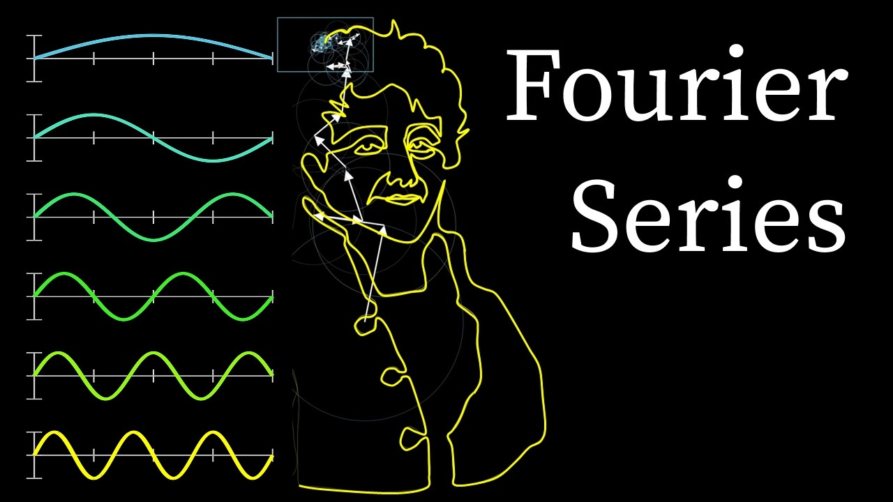

# Vídeo do 3Blue1Brown: Desenhando com círculos

**14/10/2026**

Sabe aquela aula do Domínio da Frequência, onde vimos círculos e setas girando para desenhar uma imagem? O professor compartilhou algumas imagens e simulações muito legais sobre isso, mas, para mim, o melhor material que já vi na internet sobre o assunto é um vídeo do **3Blue1Brown**!

Foi vendo este vídeo que eu finalmente entendi por que a Transformada de Fourier é tão incrível: ***qualquer*** desenho pode ser formado por círculos de tamanhos e velocidades diferentes, um girando em cima do outro. Até o rosto do próprio Fourier! 🤯

O vídeo mostra isso com um nível de clareza e animação tão bom que eu ***com certeza*** vou rever antes da prova! 😂 Ele explica melhor do que eu poderia:

[https://www.youtube.com/watch?v=r6sGWTCMz2k](https://www.youtube.com/watch?v=r6sGWTCMz2k)

O canal do 3Blue1Brown! ➡️ [https://www.youtube.com/@3blue1brown](https://www.youtube.com/@3blue1brown)

---

[Voltar à página inicial](index.md)
